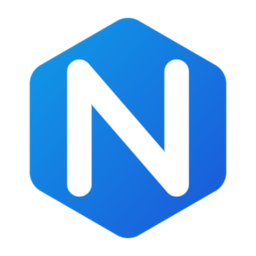
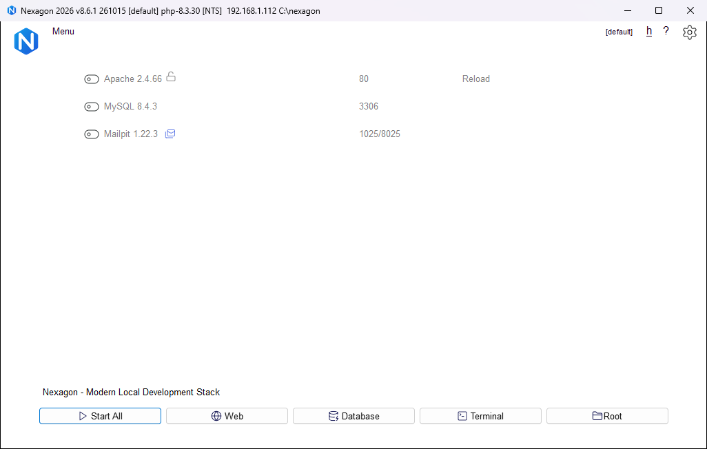

<p align="center">
  
</p>

<h1 align="center">Nexagon</h1>

<p align="center">
  <strong>Modern, Fast & Portable Local Development Stack for Windows (x86_64)</strong><br/>
  Built natively with Free Pascal & Lazarus LCL (Win32/Win64 GDI + Per-Monitor DPI v2)
</p>

<p align="center">
  
  
  
</p>

<p align="center">
  
</p>

---

## Overview

**Nexagon** is a lightweight, high-performance native Windows local development environment manager written in **Free Pascal / Lazarus LCL (`x86_64-win64`)**. It works with portable `bin/`, `etc/`, `usr/`, `www/`, and `data/` directory structures while running with zero background bloat, instant startup, non-blocking service orchestration, and full Windows 11 System Tray and Overflow Flyout support.

---

## Key Features

- **Native Win64 Binary (`nexagon.exe`)**:
  - Compiled directly to native `x86_64` machine code via Free Pascal and Lazarus LCL (`~3.7 MB` standalone executable, zero `.NET` or Electron runtime dependencies).
  - Full **Per-Monitor DPI v2** scaling and multi-resolution 32-bit RGBA icons (`16px` to `256px`).
- **Asynchronous Service Orchestrator (`Services.pas`)**:
  - Manages **Apache**, **Nginx** (with multi-worker `php-cgi.exe` FastCGI upstream pool), **MySQL / MariaDB**, **PostgreSQL**, **MongoDB**, **PHP**, **Node.js**, **Memcached**, **Redis**, **Mailpit**, **Python**, **Ruby**, **Java**, **Go**, and **Cron** jobs.
  - Non-blocking background service lifecycle (`StartService` / `StopService` / `ReloadService`) with automatic `DocumentRoot` and `DataDir` re-sync and live port/PID monitoring.
- **Zero-Configuration SSL and Auto Virtual Hosts**:
  - Automatically generates local X.509 SSL certificates (`etc/ssl/nexagon.crt` and `nexagon.key`) and registers them with the Windows Trust Store (`certutil`).
  - Auto-generates Apache and Nginx Virtual Hosts (`*.test`) and synchronizes `C:\Windows\System32\drivers\etc\hosts`.
- **Quick App Provisioning (`FrmQuickCreateWebsite.pas`)**:
  - One-click project scaffolding for **WordPress**, **Laravel**, **Symfony**, **Drupal**, **PrestaShop**, **CakePHP**, **CodeIgniter**, and custom templates defined in `usr/sites.conf`.
  - Automatically creates the MySQL database, extracts cached archives, configures `wp-config.php` or `.env`, and sets up the custom `.test` domain.
- **Built-in Developer Utilities**:
  - **Mail Catcher and Mail Analyzer (`FMailAnalyzer.pas`)**: Intercepts outgoing `mail()` payloads as `.eml` files with instant notification banners and a built-in SMTP diagnostic tool.
  - **Environment and PATH Manager (`FrmPathVariables.pas`)**: Injects or removes stack binaries from the Windows User `PATH` with `WM_SETTINGCHANGE` broadcast.
  - **Windows 11 Tray and Overflow Flyout Support (`FrmMain.pas`)**: Reliable left-click and right-click context menu activation from both the primary taskbar notification area and the Windows 11 hidden icon overflow flyout (`TopLevelWindowForOverflowXamlIsland`).

---

## Repository Structure

```text
Nexagon/
├── .github/workflows/
│   └── build.yml                        # GitHub Actions CI & Release pipeline (Windows x64)
├── assets/
│   ├── nexagon_logo.png                 # High-resolution Nexagon brand mark (256x256 RGBA)
│   ├── nexagon_demo.png                 # Application UI screenshot (English)
│   └── nexagon.ico                      # Multi-resolution Windows icon (16..256px)
├── lazarus/
│   ├── bin/
│   │   └── nexagon.exe                  # Compiled native x86_64 executable
│   └── src/
│       ├── nexagon.lpi                  # Lazarus Project Information
│       ├── nexagon.lpr                  # Main program entry & --self-check test suite
│       ├── nexagon.ico                  # Application icon resource
│       ├── Services.pas                 # Core backend engine (Services, Configs, SSL, VHosts, i18n)
│       ├── FrmMain.pas / .lfm           # Main Window & System Tray / PopupMenu UI
│       ├── FrmPref.pas / .lfm           # Preferences Dialog (General, Services & Ports, Mail)
│       ├── FrmQuickCreateWebsite.pas / .lfm # Quick App Provisioning Engine
│       ├── FMailAnalyzer.pas / .lfm     # SMTP Mail Analyzer & Tester
│       ├── FrmPathVariables.pas / .lfm  # Windows Environment Variables Manager
│       ├── FrmConsole.pas / .lfm        # Process & Netstat Output Console
│       ├── FrmVirtualHosts.pas / .lfm   # Virtual Hosts Inspector
│       ├── FrmLicense.pas / .lfm        # About / Open Source Edition Dialog
│       ├── Procfile.pas                 # Procfile background runner
│       ├── Ngrok.pas                    # Tunnel sharing integration
│       └── maxCron.pas                  # Cron expression parser & scheduler
├── nexagon.exe                          # Prebuilt standalone Win64 executable
├── LICENSE                              # MIT License
└── README.md                            # Project documentation
```

---

## Building from Source

### Prerequisites
- **Lazarus IDE** `3.6+` / `4.4+` with **Free Pascal Compiler (FPC)** `3.2.2` (`x86_64-win64`).

### Compile via CLI (`lazbuild`)
```powershell
lazbuild -B "lazarus\src\nexagon.lpi"
Copy-Item "lazarus\bin\nexagon.exe" "nexagon.exe" -Force
```

### Run Automated Self-Check Verification
```powershell
$p = Start-Process -FilePath ".\nexagon.exe" -ArgumentList "--self-check" -Wait -NoNewWindow -PassThru
Get-Content .\self_check_report.txt
```

---

## Installation

1. Copy **`nexagon.exe`** into the root directory of your local stack (alongside `bin/`, `etc/`, `usr/`, `www/`, and `data/`).
2. Launch **`nexagon.exe`**.

---

## License

Released under the [MIT License](LICENSE).
